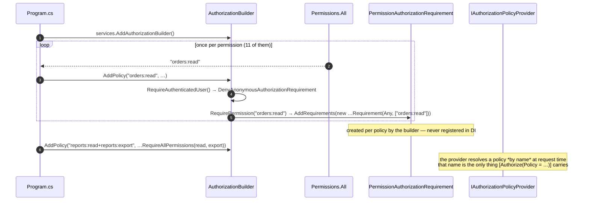
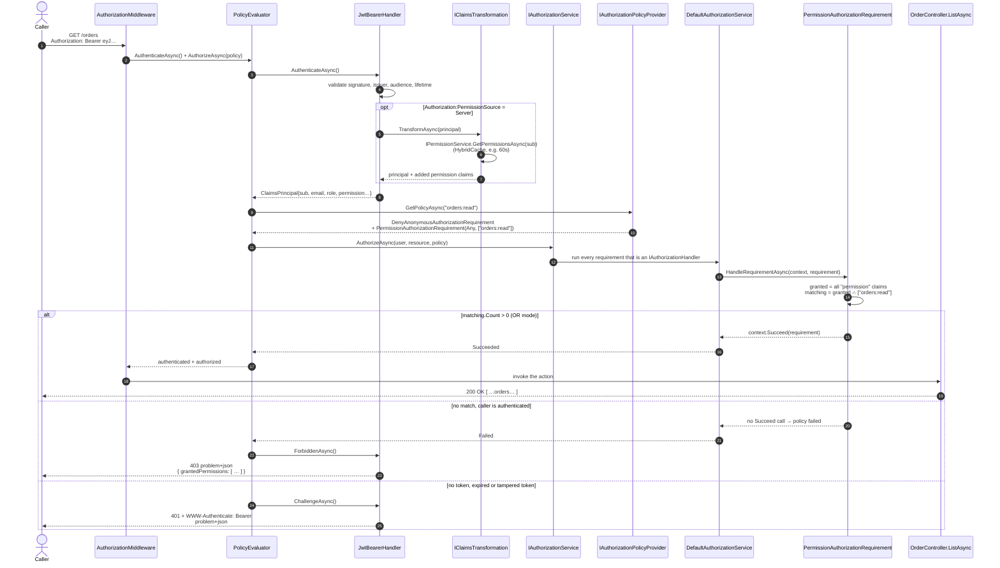
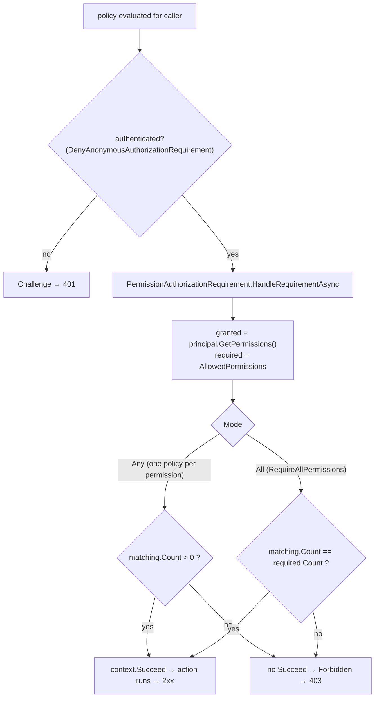

# RBAC in ASP.NET Core 10 — permission-based authorization sample

A runnable .NET 10 API built with **MVC controllers** that demonstrates **role-based access control driven by
permissions**, following
[Building Secure APIs with Role-Based Access Control in ASP.NET Core](https://milanjovanovic.tech/blog/building-secure-apis-with-role-based-access-control-in-aspnetcore)
(Milan Jovanović).

The idea in one sentence: **actions check permissions (`users:read`), never role names (`Administrator`)**.
Roles are just named bundles of permissions that live in the database, so you can change what a role may do —
or who has which role — without touching a line of action code.

```
users ──assigned to──▶ roles ──carry──▶ permissions ──checked by──▶ actions
```

## Contents

| Path | What it holds |
| --- | --- |
| `src/Rbac.Api/Authorization/` | The pattern itself: permission catalog, requirement/handler, policy registration, claims transformation |
| `src/Rbac.Api/Security/` | JWT issuing and RFC 7807 responses for 401/403 |
| `src/Rbac.Api/Data/` | EF Core model (users, roles, permissions, join tables) and the seeder |
| `src/Rbac.Api/Features/` | Controllers: Auth, Users, Orders, Reports, Roles |
| `tests/Rbac.Api.Tests/` | Unit tests for the handler and the transformation, plus a 401/403/200 matrix against the real app |
| `rbac.http` | Ready-made requests for VS Code REST Client / Rider / Visual Studio |
| `.editorconfig`, `Directory.Build.props` | The style baseline: Allman braces, file-scoped namespaces, `var` only when the type is obvious, naming rules, plus `EnforceCodeStyleInBuild` so those choices are build warnings |

## Run it

```bash
dotnet run --project src/Rbac.Api
```

The API starts on <http://localhost:5010>, creates a SQLite file (`src/Rbac.Api/rbac.db`) and seeds the RBAC
graph on startup. In Development the OpenAPI document is served at `/openapi/v1.json`.

```bash
dotnet test              # 151 tests, no external dependencies
dotnet build             # 0 warnings, 0 errors - style rules run in the build too
dotnet format --verify-no-changes   # style gate; reads .editorconfig and fails on a diff
```

## Demo accounts

| Email | Password | Role | Extra (direct) permissions |
| --- | --- | --- | --- |
| `admin@rbac.dev` | `Admin!Pass123` | Administrator | – (role has all 11) |
| `manager@rbac.dev` | `Manager!Pass123` | Manager | – |
| `support@rbac.dev` | `Support!Pass123` | Support | – |
| `viewer@rbac.dev` | `Viewer!Pass123` | Viewer | `reports:export` |
| `auditor@rbac.dev` | `Auditor!Pass123` | Auditor | – |

The Viewer is the interesting one: `reports:export` is granted **on the user**, not through a role, which is the
extension point for "this one person also needs X" without inventing a new role.

## Try the whole thing in 60 seconds

```bash
BASE=http://localhost:5010

# 1. Sign in; the response lists the roles and permissions that went into the token.
#    Needs jq (or swap the pipe for: python3 -c 'import sys,json;print(json.load(sys.stdin)["accessToken"])')
TOKEN=$(curl -s -X POST $BASE/auth/login -H 'Content-Type: application/json' \
  -d '{"email":"viewer@rbac.dev","password":"Viewer!Pass123"}' | jq -r .accessToken)

# 2. The Viewer has orders:read -> 200
curl -s -o /dev/null -w '%{http_code}\n' $BASE/orders -H "Authorization: Bearer $TOKEN"

# 3. ...but no orders:create -> 403, and the body tells you what the caller does have
curl -s $BASE/orders -X POST -H "Authorization: Bearer $TOKEN" \
  -H 'Content-Type: application/json' -d '{"customerEmail":"a@b.dev","description":"x","total":10}'
```

```json
{
  "type": "https://tools.ietf.org/html/rfc9110#section-15.5.4",
  "title": "Forbidden",
  "status": 403,
  "detail": "You are authenticated, but you do not have the permission required by this endpoint.",
  "traceId": "00-3f7c...-ab12-00",
  "grantedPermissions": [ "orders:read", "reports:export" ]
}
```

### The status code tells the whole story

| Situation | Response |
| --- | --- |
| No token / expired / tampered token | `401` + `WWW-Authenticate: Bearer` + problem document |
| Token valid, permission missing | `403` + problem document listing the permissions the caller does hold |
| Token valid, permission present | `2xx` |

### Verified matrix (from `AuthorizationMatrixTests`)

| Endpoint | Permission | Viewer | Auditor | Support | Manager | Admin |
| --- | --- | --- | --- | --- | --- | --- |
| `GET /users` | `users:read` | 403 | 403 | 200 | 200 | 200 |
| `POST /users` | `users:create` | 403 | 403 | 403 | 403 | 201 |
| `DELETE /users/{id}` | `users:delete` | 403 | 403 | 403 | 403 | 204 |
| `POST /users/{id}/roles` | `users:assign-roles` | 403 | 403 | 403 | 403 | 200 |
| `POST /users/{id}/permissions` | `users:grant-permissions` | 403 | 403 | 403 | 403 | 200 |
| `GET /orders` | `orders:read` | 200 | 403 | 200 | 200 | 200 |
| `POST /orders` | `orders:create` | 403 | 403 | 403 | 201 | 201 |
| `POST /orders/{id}/cancel` | `orders:cancel` | 403 | 403 | 200 | 200\* | 200\* |
| `GET /reports/summary` | `reports:read` | 403 | 200 | 403 | 200 | 200 |
| `GET /reports/export` | `reports:export` | **200** | 403 | 403 | 200 | 200 |
| `GET /reports/full` | `reports:read` **AND** `reports:export` | 403 | 403 | 403 | 200 | 200 |
| `GET /roles` | *any authenticated user* | 200 | 200 | 200 | 200 | 200 |

The Viewer's `GET /reports/export → 200` is the direct grant at work; `GET /reports/full → 403` is the AND rule at
work. \* Cancelling succeeds once: a second attempt returns `409` (`"title": "Already cancelled"`) because the first
caller already changed the order — that is a business rule, not an authorization decision.

## How it works

| From the blog | Where it lives here |
| --- | --- |
| Why permissions instead of roles | `Authorization/Permissions.cs` and every `[Authorize(Policy = Permissions.X)]` in `Features/` |
| `PermissionAuthorizationRequirement` + handler | `Authorization/PermissionAuthorizationRequirement.cs` |
| `CustomClaimTypes.Permission` | `Authorization/CustomClaimTypes.cs` |
| `RequirePermission` policy extensions | `Authorization/PermissionPolicyExtensions.cs` (used once per policy, at registration) |
| Permission claims in the JWT | `Security/TokenService.cs` |
| Extension point: resolve permissions server-side | `Authorization/PermissionClaimsTransformation.cs` + `Authorization:PermissionSource=Server` |
| Extension point: type-safe permissions | string constants here; the enum swap is sketched under [Extending it](#extending-it) |
| Distinguishing 401 from 403 | `Security/RbacJwtBearerEvents.cs` |

### The whole flow in three diagrams

**1. Startup: one policy per permission, named after it.** This is the only place a policy is built, and it
happens once:



**2. Request: how `GET /orders` with `[Authorize(Policy = Permissions.OrdersRead)]` is evaluated.**



The action is only reached in the first branch: authorization runs before any action code, and no action is invoked
when the policy fails. Note that nothing above ever looks at a role name — the handler only reads `permission`
claims, which is why a role can be edited in the database without a redeploy.

Two details in that diagram that are easy to get wrong:

* **The policy name is all the attribute carries, so it has to exist.** `GetPolicyAsync` returns `null` for an
  unregistered name (asserted in `PermissionPolicyRegistrationTests`) and authorizing against it throws
  `InvalidOperationException: No policy found: …` — a 500, not a 403. That is the failure mode a hand-written policy
  table usually has; the loop over `Permissions.All` removes it.
* **The policy is evaluated once per request, by `AuthorizationMiddleware`.** Not by an MVC action filter: spying on
  the handler while a real request goes through the app shows the caller chain `AuthorizationMiddleware →
  PolicyEvaluator → DefaultAuthorizationServiceImpl → DefaultAuthorizationService → HandleRequirementAsync`, and
  exactly one invocation per request. So there is no second, invisible authorization pass to reason about.

**3. The decision inside the handler** — the part that is yours, and the only part:



The handler is the requirement, so there is nothing to register: the framework runs the requirements of a policy that
implement `IAuthorizationHandler`. `Any` is the default because a policy named after one permission only ever carries
one; `All` exists for `reports:read+reports:export`.

### 1. The permission catalog — `Authorization/Permissions.cs`

```csharp
public static class Permissions
{
    public const string UsersRead = "users:read";
    public const string UsersCreate = "users:create";
    // ...
}
```

String constants, in `resource:action` form. One place to look, greppable, and the value that ends up in the token
is the same string the code checks.

### 2. One requirement that is also its handler — `Authorization/PermissionAuthorizationRequirement.cs`

```csharp
public sealed class PermissionAuthorizationRequirement : AuthorizationHandler<PermissionAuthorizationRequirement>, IAuthorizationRequirement
```

The type carries *what* is needed (`AllowedPermissions`) and answers *whether* the user has it. `HandleRequirementAsync`
collects the caller's `permission` claims once, intersects them with the requirement, and calls `context.Succeed(...)`
when the match succeeds. No `Succeed` call means the policy fails and the caller gets 403.

Two details worth copying:

* **No DI registration, on purpose.** The framework runs the requirements in a policy that implement
  `IAuthorizationHandler`, so an instance is created per policy by `RequirePermission(...)`. Registering the type in
  the container would add a second, unconfigured instance that the framework evaluates for *every* policy.
* **`MapInboundClaims = false`** in the JWT options, so a claim issued as `sub` stays `sub` instead of being silently
  remapped to `ClaimTypes.NameIdentifier`. Fewer surprises when you read a token.

Multiple permissions are combined with `PermissionMatchMode`: `Any` (OR, the default) or `All` (AND).

### 3. Clean action declarations — `[Authorize(Policy = ...)]`

An action names the permission it needs and nothing else:

```csharp
[HttpPost]
[Authorize(Policy = Permissions.OrdersCreate)]
public async Task<ActionResult<OrderResponse>> CreateAsync([FromBody] CreateOrderRequest request, CancellationToken ct)
```

…and every permission in the catalog gets a policy registered for it, once, in
`Configuration/AuthorizationExtensions.cs`:

```csharp
foreach (string permission in Permissions.All)
{
    authorization.AddPolicy(permission, policy => policy.RequireAuthenticatedUser().RequirePermission(permission));
}
```

Three things are worth understanding about that loop:

* **`RequireAuthenticatedUser()` is not optional.** A named policy *replaces* the default policy instead of adding
  to it, so a policy carrying only the permission requirement would answer an anonymous caller with `403 Forbidden`.
  With it, the caller gets `401` — which is what the matrix above asserts.
* **The permission name is the policy name**, so there is no second table of names to keep in sync, and the
  attribute argument is still a `const string` the compiler can check.
* **More than one permission at once** needs a policy of its own, and an attribute argument must be a compile-time
  constant, so that name is a `const` in `Authorization/PermissionPolicies.cs`:

  ```csharp
  public const string ReportsReadAndExport = "reports:read+reports:export";

  [HttpGet("full")]
  [Authorize(Policy = PermissionPolicies.ReportsReadAndExport)]
  public async Task<IActionResult> FullReportAsync(CancellationToken ct)
  ```

> **Why not a `RequirePermissionAttribute`?** It was the obvious way to write this, and it worked up to .NET 9 —
> `AuthorizeAttribute.GetPolicyAsync()` could be overridden to build a policy inline. .NET 10 removed that hook, and
> an attribute implementing `IAuthorizationRequirementData` is not enforced on MVC actions until .NET 11. On
> .NET 10, `[Authorize(Policy = …)]` is the supported path, which is also what the blog's attribute variant resolves
> to.

### 4. Permissions in the token — `Security/TokenService.cs`

At login the effective permissions (everything from the user's roles **plus** anything granted directly to the user)
are written as `permission` claims, next to the usual `sub`, `email` and role claims.

### 5. Where the permissions come from — `Authorization/PermissionClaimsTransformation.cs`

The blog's second extension point, implemented and switchable. `Authorization:PermissionSource`:

| Mode | Behaviour | When to pick it |
| --- | --- | --- |
| `Token` (default) | Permissions are baked into the JWT at login. One lookup per login, none per request. | Few permissions, tokens stay small, a short staleness window is fine |
| `Server` | The token carries roles only. `IClaimsTransformation` resolves the permissions per request from the database through `IPermissionService`, cached in `HybridCache`. | Permissions change often, or the list is long enough to bloat the token |

```bash
# switch the app to server-side resolution (macOS / Linux; on Windows use
# set Authorization__PermissionSource=Server, or just edit appsettings.json)
Authorization__PermissionSource=Server dotnet run --project src/Rbac.Api
```

The observable difference, demonstrated by `ServerSidePermissionResolutionTests`:

* **Token mode** — grant `orders:create` to the Viewer, and the caller's *existing* token still gets 403. They get the
  new permission after signing in again.
* **Server mode** — the very same token starts returning 201 immediately after the grant (and 403 again after the
  revoke), because permissions are resolved per request and the cache entry is invalidated by the action that changed
  the data.

Action code is identical in both modes: it only ever reads `permission` claims.

One deliberate difference from the blog's snippet: the user id is read from the `sub` claim
(`JwtRegisteredClaimNames.Sub`) rather than `ClaimTypes.NameIdentifier`, because this sample sets
`MapInboundClaims = false`. If you keep the default claim mapping, use `ClaimTypes.NameIdentifier` instead — or, as
here, turn mapping off so the token and the code agree.

```jsonc
// appsettings.json
"Authorization": {
  "PermissionSource": "Token",        // or "Server"
  "PermissionCacheDurationInSeconds": 60,
  "DisableCache": false               // true = skip the cache while demoing
}
```

### 6. Direct grants — `Features/Users/UserController.cs`

`POST /users/{id}/permissions` grants or revokes a permission on a single user, and `POST /users/{id}/roles` replaces
a user's roles. Both reject unknown names with a `400` validation problem, both invalidate the resolved-permission
cache, and both are idempotent — sending the same roles or the same grant twice changes nothing and returns `200`.
These two actions are how you would demonstrate "change access without a deployment" in a review.

### 7. Errors you can read — `Security/RbacJwtBearerEvents.cs`

Out of the box a 401/403 has an empty body. Here both are RFC 7807 problem documents, the 401 keeps its
`WWW-Authenticate` header, and a 403 includes `grantedPermissions` so the caller (or you, at 2am) can see what the
token actually resolved to.

The 400s are built by one helper, `RbacControllerBase.ValidationErrors`, so a validation problem from an action has the
same `type`, `title` and `traceId` as one the framework produces itself — the only difference is the `errors` keys,
which the action chooses (`roles`, `permissions`, `request`, …) instead of being derived from property paths.

## Two production notes this sample does not do for you

* **Database creation.** The startup initializer calls `EnsureCreated()` so the sample runs with zero setup. A real
  project should use `dotnet ef migrations add Initial` and run migrations on deploy.
* **Signing key and configuration.** `Jwt:SigningKey` in `appsettings.json` is a development value. In a real app keep
  the key in a secret store (or use asymmetric signing with a real JWKS), and rotate it with a key id (`kid`) so
  existing tokens survive the change. `JwtOptions` is validated on startup, so a missing or too-short key fails fast.

## Data model

```text
AppUser ──< UserRole >── Role ──< RolePermission >── Permission
   │                                                   ▲
   └──────────< UserPermission >───────────────────────┘   (grants that bypass roles)
```

| Table | Holds |
| --- | --- |
| `Permissions` | The catalog (`users:read`, …) |
| `Roles` | `Administrator`, `Manager`, `Support`, `Viewer`, `Auditor` |
| `RolePermissions` | Which permissions a role carries — edit this table to change RBAC |
| `Users` | Accounts, password hashes, active flag |
| `UserRoles` | Which roles a user has |
| `UserPermissions` | Permissions granted straight to a user |

The role bundles live in one readable place, `Data/RbacSeeder.cs`:

```csharp
public static readonly IReadOnlyDictionary<string, string[]> RolePermissions =
    new Dictionary<string, string[]>(StringComparer.OrdinalIgnoreCase)
    {
        [RoleNames.Administrator] = [.. Permissions.All],
        [RoleNames.Manager] = [Permissions.UsersRead, Permissions.UsersUpdate, /* … */],
        [RoleNames.Support] = [Permissions.UsersRead, Permissions.OrdersRead, Permissions.OrdersCancel],
        [RoleNames.Viewer] = [Permissions.OrdersRead],
        [RoleNames.Auditor] = [Permissions.ReportsRead]
    };
```

Add `reports:export` to `Manager` there (or `PUT` a row into `RolePermissions`) and every Manager can export reports —
with no code change and no redeploy.

## Tests

```bash
dotnet test
```

151 tests. The unit tests have no HTTP and no fixture host — they instantiate the type and assert on its
behaviour. The data-layer units run against a real SQLite database (in memory, through the same provider the app
uses), because an EF in-memory provider would happily accept LINQ that SQLite rejects.

**Unit — authorization (`tests/Rbac.Api.Tests/Unit/`)**

| File | What it pins down |
| --- | --- |
| `PermissionAuthorizationRequirementTests` | OR/AND semantics, trimming and de-duplication, empty input, and the case that matters most: **role claims alone never authorize anything** |
| `PermissionPolicyTests` | The same requirement evaluated through the real `IAuthorizationService`, and what `RequirePermission` / `RequireAllPermissions` put on a policy |
| `PermissionPolicyRegistrationTests` | That every permission in the catalog resolves to a policy through the real policy provider, that each one also demands an authenticated user (the 401-vs-403 trap), and that the composed `reports:read+reports:export` policy really needs both |
| `PermissionPrincipalExtensionsTests` | `GetPermissions`, `HasPermission`, `HasAllPermissions`, including that permission names are matched case-sensitively and that role claims are not permissions |
| `PermissionClaimsTransformationTests` | Adds the claims, stays idempotent when it runs twice, caches per user, honours `DisableCache`, and ignores anonymous principals and tokens without `sub` |
| `PermissionsTests` | Catalog invariants: no duplicates, every name is `resource:action`, `GetResource`/`GetAction` round-trip |

**Unit — security and data (`tests/Rbac.Api.Tests/Unit/`)**

| File | What it pins down |
| --- | --- |
| `TokenServiceTests` | Decodes the JWT payload the way a client would: `sub`/`email`/`jti`, role and permission claims in `Token` mode, no permission claims in `Server` mode, a unique `jti` per token, an expiry that matches the configured lifetime, and a token that fails validation when signed with another key |
| `RbacJwtBearerEventsTests` | 401 and 403 bodies, the `WWW-Authenticate` header, the `grantedPermissions` extension (and its absence), and a different `detail` per authentication failure |
| `EfPermissionServiceTests` | The permission query: role bundles, direct grants, the union, de-duplication when a permission arrives twice, sorted output, unknown users, and the cascade when a user is deleted |
| `DatabaseAuthorizationCatalogTests` | Known roles come from the database, unknown names are reported once and trimmed, and blank input is not an error |
| `RbacSeederTests` | The seeded graph is internally consistent: the Administrator carries all 11 permissions, no bundle names a permission outside the catalog, every permission is reachable, and each demo user resolves to its roles plus its direct grants |

**Integration (`tests/Rbac.Api.Tests/Integration/`)** — these boot the real `Program.cs`

| File | What it covers |
| --- | --- |
| `AuthorizationMatrixTests` | The table above, plus role assignment and permission grants changing what a user can do, idempotent writes, and the delete/cancel flows |
| `ProblemDetailsTests` | 401/403 payloads, the challenge header, a tampered token, and validation problems for unknown role names |
| `AuthEndpointTests` | Login, `/auth/me`, the role catalog, credential and validation failures |
| `ServerSidePermissionResolutionTests` | `Server` mode: no permission claims in the token, and a grant or revoke taking effect immediately with an unchanged token |

Each integration test class boots `Program.cs` through `WebApplicationFactory` against its own throwaway database, so
the seeded roles and permissions under test are genuine.

## Extending it

* **Minimal API endpoints instead of controllers.** The policy-building extensions are still there, so a
  `MapXxx` endpoint needs no registration and no policy name — and it accepts a permission list that is only known at
  run time:

  ```csharp
  app.MapPost("/orders", CreateOrder)
      .RequireAuthorization(policy => policy.RequirePermission(Permissions.OrdersCreate));

  app.MapGet("/reports/full", FullReport)
      .RequireAuthorization(policy => policy.RequireAllPermissions(Permissions.ReportsRead, Permissions.ReportsExport));
  ```

  Both styles coexist happily: the requirement, the handler and the claims are the same, only the declaration site
  differs.

* **Type-safe permissions.** Replace the string constants with an enum plus a conversion when reading claims and
  issuing them. The handler compares claim *strings*, so only the catalog, the seeder and the token issuing change.
  Note that `[Authorize(Policy = …)]` takes a `string`, so the enum would be turned into a policy name at
  registration time.

* **Audit trail.** `PermissionAuthorizationRequirement` logs why each check passed or failed at `Debug` level. Turn it up
  for `Rbac.Api.Authorization` to see, per request, which permission was missing.
